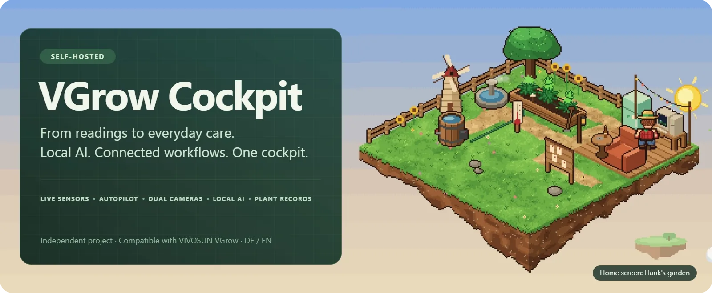
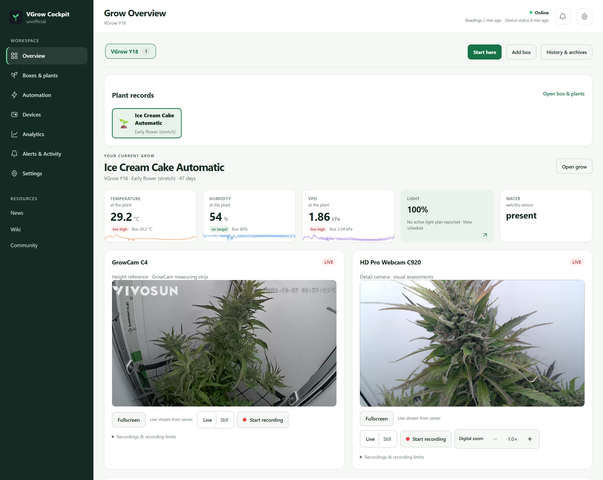
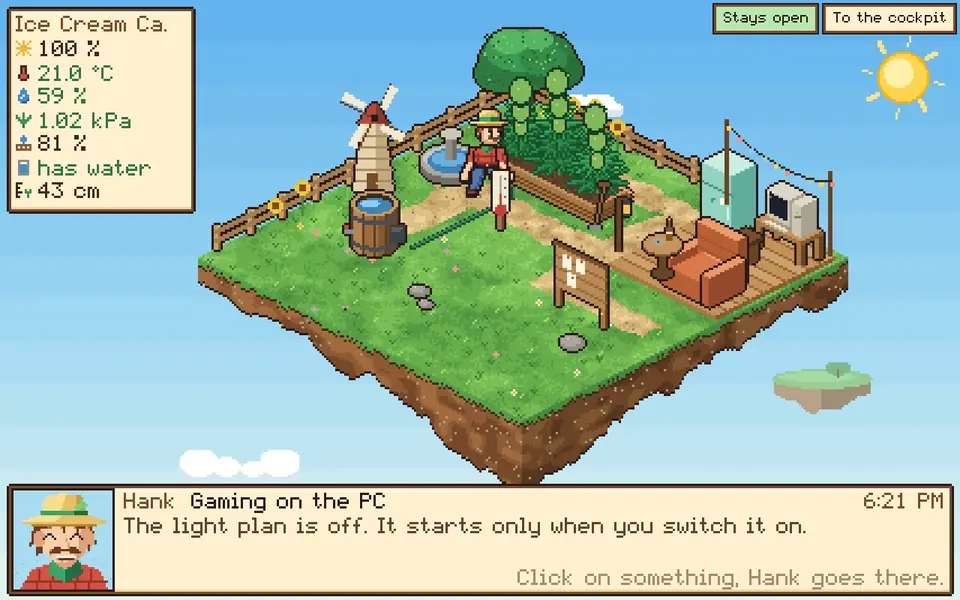
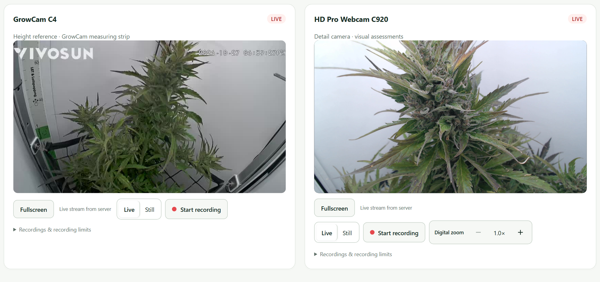
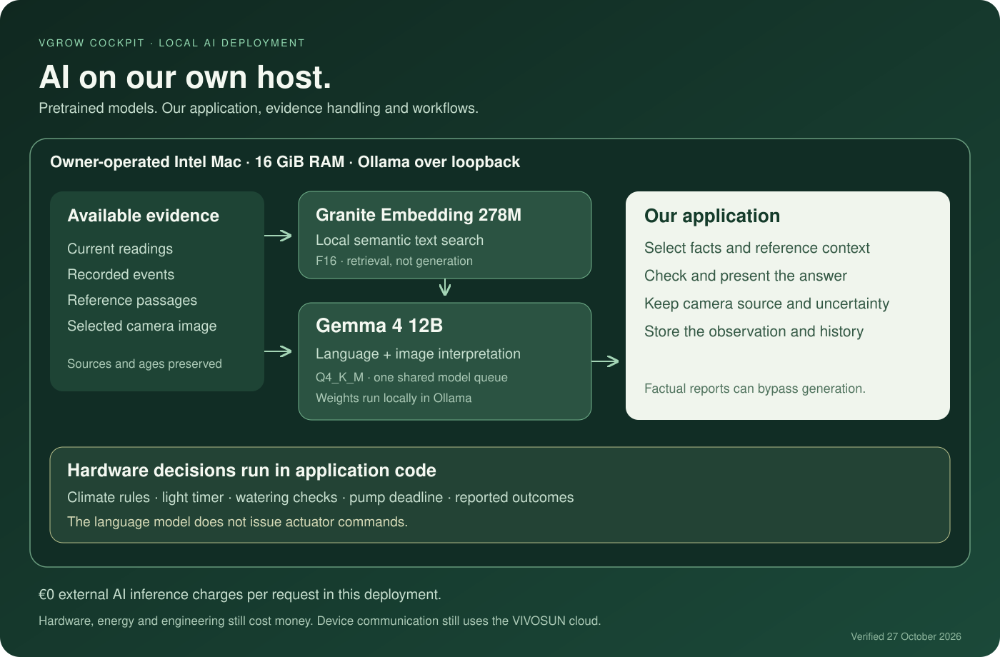
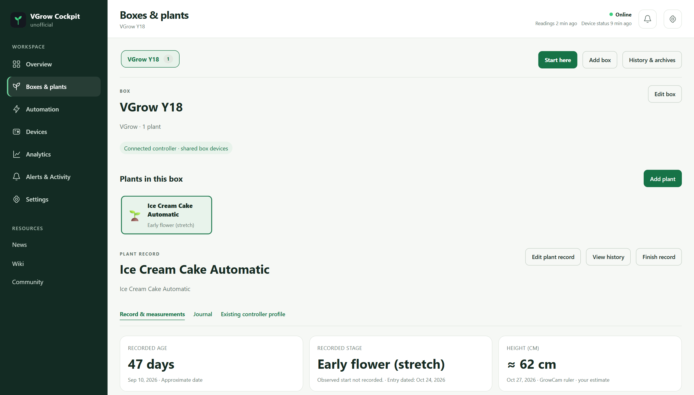

<p align="center"></p>

# VGrow Cockpit

**A working grow-box cockpit with explainable automation, two cameras, plant history and AI running on the owner's hardware.**

[](https://github.com/eugnmueller-87/vgrow-showcase/releases)    

Built by [Eugen Mueller](https://www.linkedin.com/in/eugen-mueller), a VGrow owner exploring how to make everyday care easier to understand and automate. Independent of VIVOSUN.

[Run it yourself](#run-it-yourself) · [What's coming](#whats-coming) · [Screenshots](docs/gallery.md) · [Product workflows](docs/workflows.md) · [Local AI](docs/ai-models.md) · [Roadmap](docs/roadmap.md) · [LinkedIn](https://www.linkedin.com/in/eugen-mueller)

**Free to use, change and share.** Since 7 November 2026 this repository carries the application itself under the [MIT licence](LICENSE): the cockpit, the climate autopilot, the grow plan, Hank and his garden, and the setup guides. Each [release](https://github.com/eugnmueller-87/vgrow-showcase/releases) is a snapshot of the version the owner runs on his own VGrow. Between releases the work goes on in a private repository, and new versions arrive here as new releases.



## From readings to everyday care

As a beginner using a VGrow, I could see readings and switch equipment, but still had to work out the daily routine. A light showing 100% did not explain when it would turn off. USB power did not prove the humidifier was making mist. A pump switch did not establish an appropriate watering routine.

I started with a phone control page and built it into a workspace that connects the observations, the explanation, the recurring routine and the resulting history.

## The working product

| Need | What the cockpit brings together |
|---|---|
| Understand the environment | Plant-probe and box readings, independent freshness indicators and environmental history |
| Understand a control decision | Climate automation with reasons, manual takeover and reported outcomes |
| See the plant | GrowCam for the measuring-strip perspective and Logitech C920 for detail |
| Organize recurring care | Daily light timer, watering opportunities, water-demand checks and a pump stop watchdog |
| Keep each plant's history | Separate records, observations, journals, completion, archives and export |
| Learn and connect | Indexed wiki, plant-health references, fertilizer library, news and public community metadata |
| Ask about the actual setup | Hank combines current facts and reference material with optional local language and vision models |

## Hank's garden

Since 6 November 2026, the cockpit turns into a small pixel world after a minute without input. Everything in it is a reading from the box. The sun climbs with the grow light's brightness, the windmill turns with the exhaust fan, and when the pump runs, Hank fetches water at the barrel and waters the bed. Click on something and he walks over and tells you what it stands for. The garden only reads the box. It never switches anything.



*Recorded in the cockpit's demo mode, with made-up values. The cover at the top comes from a screen recording of the owner's installation.*



## AI on my own hardware

**Gemma 4 12B** provides language and image interpretation. **Granite Embedding 278M** provides semantic reference search. Both run through Ollama on an owner-operated Intel Mac with 16 GiB RAM.

The application, evidence handling, retrieval, orchestration, validation and control workflows were built around pretrained models. The base models were not trained by this project. This deployment has no external LLM provider API key or per-request inference bill. Hardware, electricity and development still have costs.



Climate rules, schedules, water calculations and pump deadlines run in application code. The language model explains and interprets; it does not issue hardware commands. Device communication still uses the VIVOSUN cloud. [Verified model roles](docs/ai-models.md) · [Cost breakdown](docs/costs.md).

## Run it yourself

**Try the demo first.** It needs no box and no account: made-up readings, its own state folder, no VIVOSUN login, no commands to any device. With Python 3.12:

```sh
git clone https://github.com/eugnmueller-87/vgrow-showcase.git
cd vgrow-showcase
python3.12 -m venv .venv
.venv/bin/python -m pip install -r requirements.txt
.venv/bin/python -m vgrow --demo --host 127.0.0.1
```

On Windows use `py -3.12 -m venv .venv` and `.venv\Scripts\python.exe`. Open the link the terminal prints; it carries the demo's access key.

**Then connect your own VGrow.** Copy [`vgrow.env.example`](vgrow.env.example) to `~/.vgrow.env`, enter your VIVOSUN login and follow [Getting started](docs/getting-started.md): the read-only connection check, a computer that stays on, cameras, push alerts and the optional local AI.

What the full automation uses in the owner's setup:

| Part | What it does |
|---|---|
| VIVOSUN VGrow Y18 | The box: light, fans, sensors, two switchable USB ports |
| A computer that stays on | Runs the cockpit; the owner uses an Intel Mac with 16 GB and no graphics card |
| Drip pump on USB 1, humidifier on USB 2 | Watering and humidity, both switched by the cockpit |
| Ecowitt gateway with a WH51 soil sensor | Soil moisture, read on the home network |
| GrowCam C4 | Height against the measuring strip, daily photos |
| A USB close-up camera (optional) | Detail photos for the plant and pest checks; the sharper at short distance, the better |
| Ollama with `gemma4:12b` and `granite-embedding:278m` (optional) | Hank's answers and the photo checks, on your own computer |

**Before you let it run unattended:**

- It is unofficial. It talks to the VIVOSUN cloud like the manufacturer's app does, through the open-source integration it builds on. VIVOSUN has not approved it, and a change on their side can stop it.
- It switches real equipment. The pump has a hard time limit and its own stop watchdog. Check your setup in **Observe** before you choose **Automatic**.
- It comes without warranty ([MIT](LICENSE)). The private strain lexicon and the strain encyclopedia are not included; see the [notice](NOTICE.md).

## Current evidence and next steps

Checkpoint: **27 October 2026**. The gallery contains **12 real installation captures**, visually reviewed and acquired with browser writes blocked. These are screenshots of the owner's running installation.

Status on 7 November 2026: climate and light run on their own in the owner's installation. The autopilot regulates the fans, and the grow plan sets the light hours and brightness from the plant's stage. Watering is the open part: the pot is set up, the pump switches and a soil sensor reads, but automatic watering waits for a measured pump flow and a calibrated soil sensor. Refills, maintenance and some observations remain manual.

The [roadmap](docs/roadmap.md) of 27 October distinguishes delivered software, remaining live setup and future validation. The short list of what comes next is below.

## What's coming

No dates, in rough order. Each update arrives here as a new release; choose **Watch → Custom → Releases** to hear about it.

- **Watering on its own**, by the plant's need: a measured pump flow, a calibrated soil sensor, hard limits.
- **One switch for everything**: light, climate, watering and feeding follow the plant's stage.
- **Pest watch** with the close-up camera: when the AI is unsure, it still asks you to take a look.
- **Several plants and boxes**, with more accessories per box.
- **Hank looks before he answers**: he searches everything he has and asks back when he is unsure.
- **A grow report** per run, to share and compare.
- **Installers**: Windows first, then macOS.
- **Later**: Apple devices and sharing with the community.



## A contribution to product development

VIVOSUN's published Smart Grow System direction makes this a relevant collaboration: connecting equipment, intelligence and easier daily use. The [manufacturer context](docs/vivosun-context.md) relates that direction to our verified Y18 installation. We have not independently evaluated the X42 or demonstrated learned recipe optimization.

I would like to contribute the perspective of an owner who explored the technology and built a working extension around it, through product development, integration and testing, potentially as part of the team.

A short demonstration and focused pilot can establish what improves daily use and what to develop together. More about my background: [LinkedIn](https://www.linkedin.com/in/eugen-mueller).

## Explore the product

| Read | What it covers |
|---|---|
| [Getting started](docs/getting-started.md) | Demo, connecting your VGrow, running on a Mac, cameras, local AI, first-use checklist |
| [Operating reference (German)](docs/operations.md) | Every setting, rule and service detail |
| [Architecture](docs/architecture.md) | Components, data and who controls what |
| [Hank's garden](docs/garden.md) and [grow plan](docs/grow-plan.md) | How the garden reads the box, and how the plan ties devices to the plant |
| [All documentation](docs/README.md) | The full index |
| [Workflow guide](docs/workflows.md) | Onboarding, climate, light, watering, refills, Hank, camera review and record completion |
| [AI deployment](docs/ai-models.md) | Verified model identities, host, roles and execution boundaries |
| [Screenshot gallery](docs/gallery.md) | All 12 current images with capture context and provenance |
| [Roadmap](docs/roadmap.md) | Delivered capabilities, remaining setup and next milestones |
| [Costs](docs/costs.md) | Local inference, equipment, energy and explicitly unknown costs |
| [VIVOSUN context](docs/vivosun-context.md) | Their published direction and the collaboration opportunity |

**Built with AI help.** The code and the documentation were written with Claude (Anthropic) and Codex (OpenAI). The author decides what goes in and runs it every day on his own VGrow.

**Licence.** The application is [MIT](LICENSE)-licensed. It comes without the private Git history, credentials, model weights and the third-party strain data. Third-party parts and images keep their own licences, listed in the [notice](NOTICE.md).
