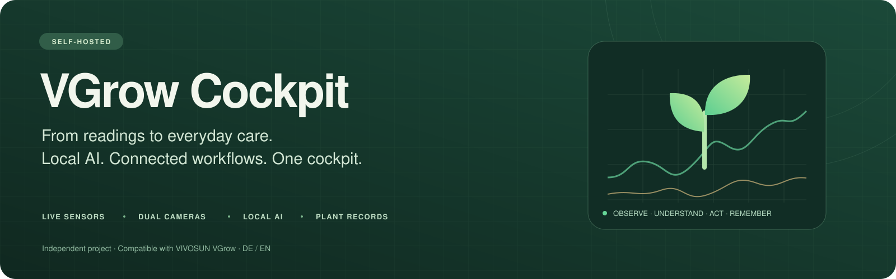
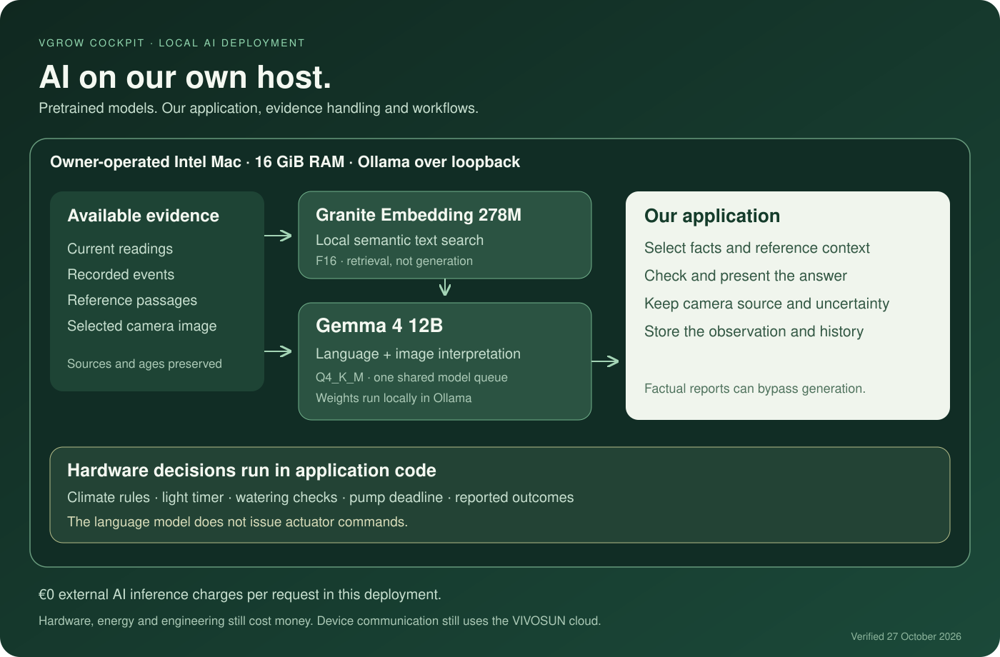

# VGrow Cockpit

**A working grow-box cockpit with explainable automation, two cameras, plant history and AI running on the owner's hardware.**

Built by [Eugen Mueller](https://www.linkedin.com/in/eugen-mueller), a VGrow owner exploring how to make everyday care easier to understand and automate. Independent of VIVOSUN.

[Product workflows](docs/workflows.md) · [Local AI](docs/ai-models.md) · [Screenshots](docs/gallery.md) · [Roadmap](docs/roadmap.md) · [Costs](docs/costs.md) · [LinkedIn](https://www.linkedin.com/in/eugen-mueller)

This repository is a browsable product showcase. It contains documentation and reviewed screenshots. The application implementation stays in a separate private repository.

## From readings to everyday care

As a beginner using a VGrow, I could see readings and switch equipment, but still had to work out the daily routine. A light showing 100% did not explain when it would turn off. USB power did not prove the humidifier was making mist. A pump switch did not establish an appropriate watering routine.

I started with a phone control page and built it into a workspace that connects the observations, the explanation, the recurring routine and the resulting history.

## The working product

| Need | What the cockpit brings together |
|---|---|
| Understand the environment | Plant-probe and box readings, independent freshness indicators and environmental history |
| Understand a control decision | Climate automation with reasons, manual takeover and reported outcomes |
| See the plant | GrowCam for the measuring-strip perspective and Logitech C920 for detail |
| Organize recurring care | Daily light timer, watering opportunities, water-demand checks and a pump stop watchdog |
| Keep each plant's history | Separate records, observations, journals, completion, archives and export |
| Learn and connect | Indexed wiki, plant-health references, fertilizer library, news and public community metadata |
| Ask about the actual setup | Hank combines current facts and reference material with optional local language and vision models |

## Local AI with a defined role

**Gemma 4 12B** provides language and image interpretation. **Granite Embedding 278M** provides semantic reference search. Both run through Ollama on an owner-operated Intel Mac with 16 GiB RAM.

The application, evidence handling, retrieval, orchestration, validation and control workflows were built around pretrained models. The base models were not trained by this project. This deployment has no external LLM provider API key or per-request inference bill. Hardware, electricity and development still have costs.

Climate rules, schedules, water calculations and pump deadlines run in application code. The language model explains and interprets; it does not issue hardware commands. Device communication still uses the VIVOSUN cloud. [Verified model roles](docs/ai-models.md) · [Cost breakdown](docs/costs.md).

## Current evidence and next steps

Checkpoint: **27 October 2026**, application revision **`4e49083`**. The gallery contains **12 real installation captures**, visually reviewed and acquired with browser writes blocked.

Climate automation is active in the captured installation. The light and watering timers are built and deployed, but their schedules are not configured or enabled. Pot setup and physical pump calibration remain open. Refills, maintenance and some observations remain manual.

The next milestone is a physically verified daily care baseline, followed by reviewed stage recommendations, reliable visual tracking, more hardware adapters and a tested setup experience for other users. The [roadmap](docs/roadmap.md) distinguishes delivered software, live setup and future validation.

## A contribution to product development

VIVOSUN's published Smart Grow System direction makes this a relevant collaboration: connecting equipment, intelligence and easier daily use. The [manufacturer context](docs/vivosun-context.md) relates that direction to our verified Y18 installation. We have not independently evaluated the X42 or demonstrated learned recipe optimization.

I would like to contribute the perspective of an owner who explored the technology and built a working extension around it, through product development, integration and testing, potentially as part of the team.

A short demonstration and focused pilot can establish what improves daily use and what to develop together. More about my background: [LinkedIn](https://www.linkedin.com/in/eugen-mueller).

## Explore the product

| Read | What it covers |
|---|---|
| [Workflow guide](docs/workflows.md) | Onboarding, climate, light, watering, refills, Hank, camera review and record completion |
| [AI deployment](docs/ai-models.md) | Verified model identities, host, roles and execution boundaries |
| [Screenshot gallery](docs/gallery.md) | All 12 current images with capture context and provenance |
| [Roadmap](docs/roadmap.md) | Delivered capabilities, remaining setup and next milestones |
| [Costs](docs/costs.md) | Local inference, equipment, energy and explicitly unknown costs |
| [VIVOSUN context](docs/vivosun-context.md) | Their published direction and the collaboration opportunity |

The showcase contains no application source, private prompts, model weights, calibration implementation, credentials or Git history from the application repository. Original rights and third-party attribution are described in the [notice](NOTICE.md).
