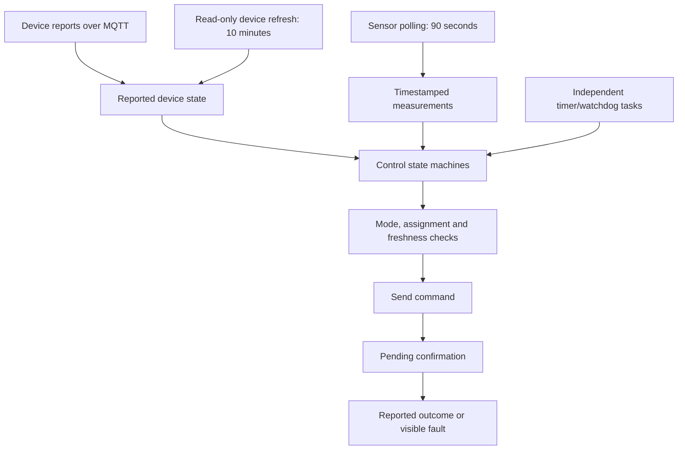

# Architecture and control ownership

[Repository](../README.md) · [Setup](getting-started.md) · [Development](development.md)

VGrow Cockpit is a Python/aiohttp application with a framework-free browser interface. The deployed installation
runs under launchd on a Mac. The browser may connect locally or over Tailscale. VIVOSUN REST and AWS IoT MQTT
remain the route to the controller; local AI inference does not remove that cloud dependency.

## Components

| Layer | Source | Responsibility |
|---|---|---|
| HTTP application | [`server.py`](../vgrow/server.py) | Authentication, API assembly, static assets and service lifecycle |
| Device integration | [`box.py`](../vgrow/box.py), [`vivosun/`](../vgrow/vivosun/) | Login/reconnection, MQTT reports, sensor polling and commands |
| Climate control | [`autopilot.py`](../vgrow/autopilot.py) | Device decisions, manual pauses, confirmations and configured bounds |
| Humidifier | [`automation.py`](../vgrow/automation.py), [`humidifier_tank.py`](../vgrow/humidifier_tank.py) | Hysteresis/fault handling, mist/refill observations and conditional estimates |
| Scheduled light | [`light_schedule.py`](../vgrow/light_schedule.py), [`light_view.py`](../vgrow/light_view.py) | Daily timer and separately reported light state/history |
| Watering | [`watering.py`](../vgrow/watering.py), [`pump_history.py`](../vgrow/pump_history.py) | Timed pump runs, independent stop watchdog and reported run history |
| Water demand | [`thirst.py`](../vgrow/thirst.py) | Estimated deficit, manual observations and forecasts; a gate can only skip or shorten scheduled watering |
| Thirst index | [`thirst.py`](../vgrow/thirst.py) | Pot ledger, stage plan and forecast, and the need check before every scheduled watering slot; reads only, switches nothing ([details](durst-index.md)) |
| Commands | [`portguard.py`](../vgrow/portguard.py), [`budget.py`](../vgrow/budget.py) | Accessory assignment and persistent command accounting |
| Records | [`workspace.py`](../vgrow/workspace.py), [`record_export.py`](../vgrow/record_export.py) | Box/plant identities, revision checks, lifecycle and scoped exports |
| Measurements | [`measurements.py`](../vgrow/measurements.py) | Local measurement storage and reported history |
| Hank protocol | [`hank_protocol.py`](../vgrow/hank_protocol.py) | Persistent issues, controller decisions, command receipts, device confirmations and later measured responses; observes without switching devices |
| Cameras | [`camera.py`](../vgrow/camera.py), [`usb_camera.py`](../vgrow/usb_camera.py) | GrowCam/network capture, shared USB helper, snapshots and recordings |
| Vision / assistant | [`vision.py`](../vgrow/vision.py), [`hank/`](../vgrow/hank/) | Source-labelled observations, retrieval, deterministic replies and optional model work |
| Jev watch | [`hank/jev.py`](../vgrow/hank/jev.py), [`jev_watch_report.py`](../scripts/jev_watch_report.py) | Optional, key-gated: logs TypeSafe Jev's judgments of each Hank question beside the router's route; changes no answer |
| Reference and community | [`wiki.py`](../vgrow/wiki.py), [`wiki_tools.py`](../vgrow/wiki_tools.py), [`community.py`](../vgrow/community.py) | Reference API, reading/review state, public metadata and source caches |
| Browser | [`web/`](../web/) | Semantic HTML, CSS, localized JavaScript, hash routes and uPlot charts |

The module name `budget.py` is historical. It retains command records; hourly and daily actuator quotas no longer
block commands. Login and reconnection backoff are separate mechanisms.

## Four different clocks

A fresh HTTP response does not make an old sensor measurement fresh. A sent command does not become a confirmed
setting. A model answer is neither of those things. Each retains its own timestamp and origin.

## Who owns a control

The climate autopilot adjusts eligible devices in Off/Observe/Automatic modes. The humidifier rule has its own
enable state and fault handling. The daily light timer owns scheduled light switching when enabled; the autopilot
does not simultaneously ramp its brightness. The pump belongs to its timed watering controller, not the climate
rule. A manual command creates the relevant takeover/pause behavior.

The daily light timer requires fresh manual-mode/no-plan reports and does not replace a VIVOSUN device plan.
The watering controller requires its configured pump role and supply/connection conditions. Before each scheduled
slot it asks the thirst index's need check through one hook (`need_gate`), which can only skip that slot or shorten
its run; "Water once" is never asked. Stop deadlines do
not wait for a 90-second sensor poll or an Ollama response. Lost connectivity still limits what the host can
actually switch; these timers are not installed in the hardware.

Hank reads snapshots and reports. Its language model imports no actuator controller and cannot publish a hardware
command. Explicit UI actions go through the same guarded command path as other controls.

## Camera and model lifecycles

GrowCam is a local-network video source. The C920 is captured by a dedicated macOS helper using a shared local
socket. The helper has its own normal camera permission and selects the configured USB device without a built-in
camera or audio fallback. Browser viewers reuse the sources; page navigation does not create a second capture.

Digital zoom/pan is a viewer transform. It preserves source recordings. Still/live access is separate from asking
for a new model observation. An observation records the selected camera and does not silently fall back to another.
Chat and vision share a model queue to bound memory pressure. Essential device controllers are independent of it.

## Local state and ownership

The state root is `~/.vgrow-control/` on macOS or `%LOCALAPPDATA%\vgrow-control` on Windows. Demo mode uses a separate
demo root. Credentials come from the user's environment file, outside the repository.

| Data | Location / coverage |
|---|---|
| Access and preferences | `access-key`, `settings.json` |
| Workspace and observation history | `workspace/inventory.sqlite3` |
| Climate controller state | `boxes/<box>/` |
| Hank issue/task protocol | `boxes/box-1/hank-protocol.sqlite3`, separate from measurements and controller settings |
| Light and pump timers | `boxes/box-1/light-schedule.json`, `boxes/box-1/watering.json` in the present installation |
| Thirst index | `boxes/<box>/thirst-pot.json`, `thirst-state.json`, `thirst-log.jsonl` |
| Humidifier refill/runtime records | `humidifier-tank.json` |
| Reading collections and editorial state | `wiki/reading.sqlite3` |
| Photos, assessments, recordings | State-root media directories, including separate USB recordings |
| Community metadata cache | `community/*.json` |
| Browser-only community choices | Browser localStorage: saved metadata, search and read markers |

The existing controller profile and the workspace's individual plant records are separate. A new box record does
not create a device adapter. A plant's box-assignment intervals establish coverage for sensor exports; shared
box data is not a private sensor attached to that plant. Box-level media does not yet have verified per-plant
ownership. [Record and export details](record-lifecycle.md).

Back up the complete state root, not just the inventory database. Copy active SQLite databases using SQLite's
backup support, or stop the service before copying. Browser-only preferences require separate handling.

## Failure behavior worth testing

| Failure | Observable behavior |
|---|---|
| Stale/missing sensor values | Freshness is shown; control rules apply their stale-data behavior |
| Unconfirmed device command | Pending state, bounded retries and visible fault rather than false success |
| Interrupted pump run | Persisted run is stopped on restart rather than resumed |
| Missed light/pump transitions | Light reconciles the current phase; missed pump starts are skipped |
| Disconnected USB camera | Source becomes offline and acquisition retries without selecting another camera |
| Missing/busy local model | Factual/deterministic paths remain available; controllers retain their own tasks |
| Failed public community source | Last successful cached metadata remains labelled with source health |
| Concurrent record editing | Revision conflict prevents overwriting a newer record |

Run only one real controller host per account. Local guards and ledgers do not coordinate two independent hosts.
The demo is the appropriate target for development and browser mutation checks.
