# The cockpit in pictures

[Product overview](../README.md) · [Workflows](workflows.md) · [AI models](ai-models.md) · [Roadmap](roadmap.md)

These images show the real running installation. They were captured through the existing authenticated browser
interface with hardware writes blocked. They illustrate product behavior, not a recommended growing setup.
All 12 application screenshots were refreshed on 27 October 2026 and visually reviewed before inclusion. No model
responses or live operating settings were invented for the presentation.

## Overview

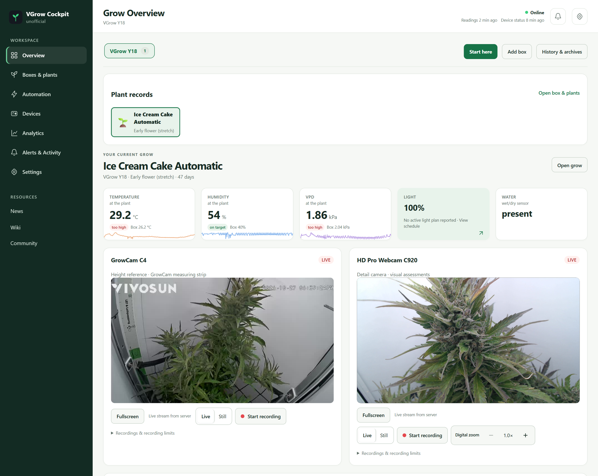

The probe and box readings remain separate, as do reading freshness and device-report freshness. The Light tile
opens the schedule view. Each camera retains its own controls.

## Both cameras, without an overlay over the footage

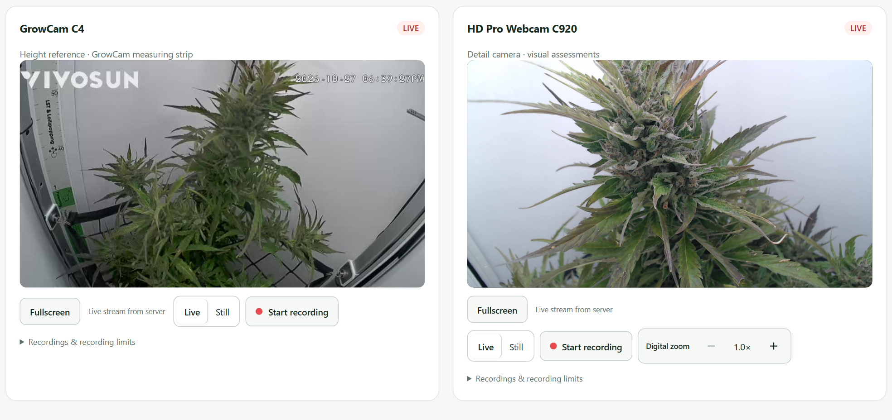

The wider GrowCam view is the measuring-strip reference. The C920 shows detail. Zoom and recording controls sit
below the footage. This capture uses 1× digital zoom. The GrowCam's embedded timestamp belongs to the camera's
own clock; it is preserved as captured and should not be used as the documentation capture time.

## Automation with a reason for each device

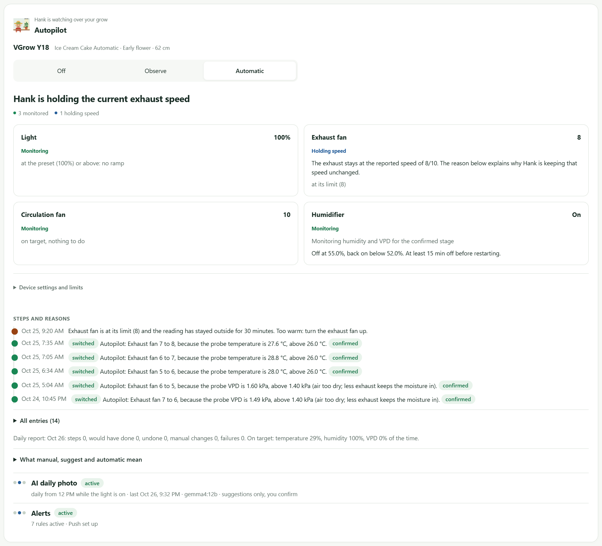

The captured installation is holding the exhaust at its configured automatic limit. The humidity thresholds and
fan settings shown belong to that installation. This is an observed controller state, not evidence of a universal
optimal setting.

## Light control separates reports from the cockpit timer

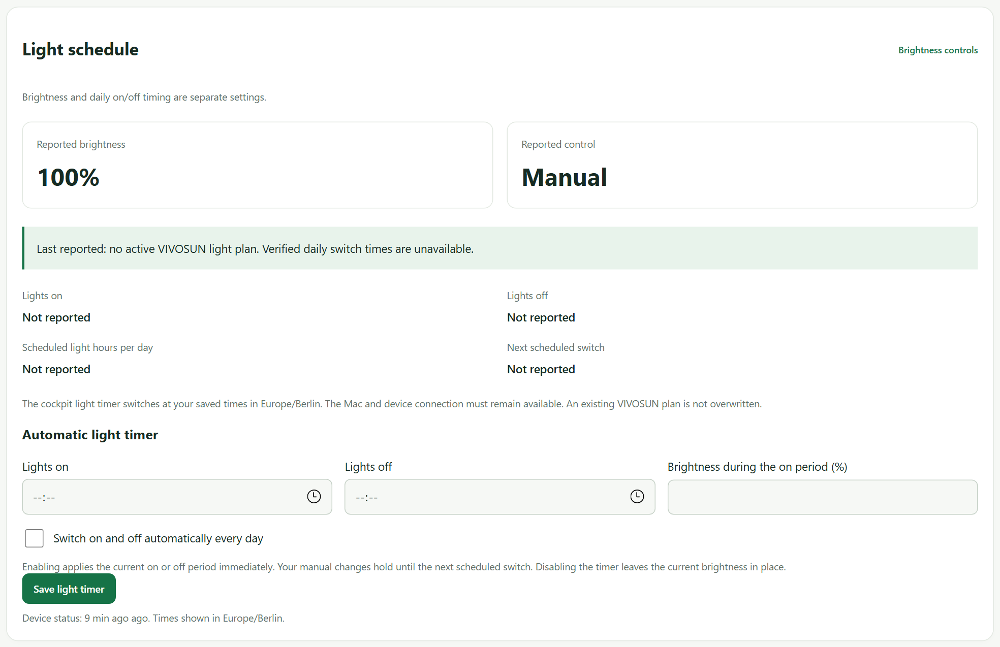

The lamp reports brightness and manual control. No manufacturer daily plan is reported, and the new cockpit
timer has not been configured or enabled. Empty time fields are intentionally preserved; the picture does not
claim that an automatic daily schedule is active.

## Water-demand setup

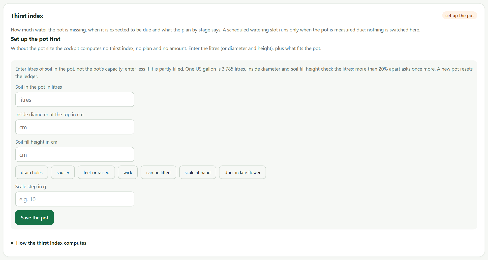

The current installation has not saved the pot setup required for an estimate. The screen asks for actual soil volume
and observations rather than inventing a demand value. This is a captured setup state, not a calibrated forecast.

## Scheduled watering and physical confirmation

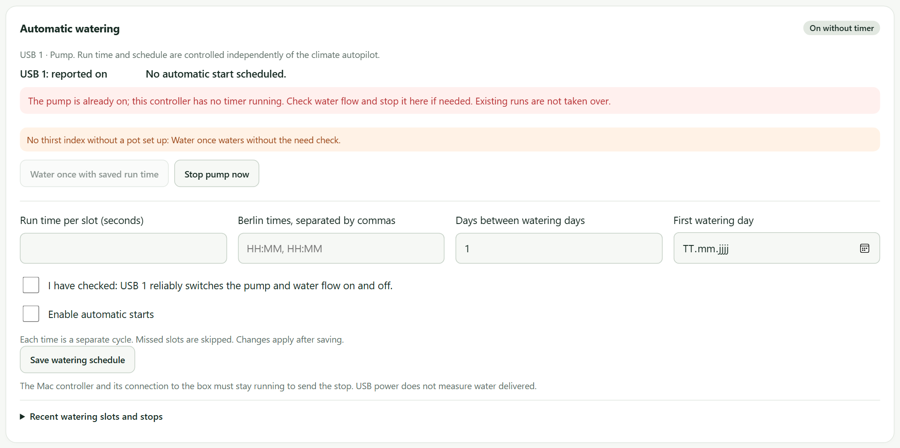

The USB port reports power on, but this controller has no timed run or enabled start schedule. The screen keeps
that distinction visible. Power does not confirm water delivery; the capture performed no pump action. Pot setup,
flow calibration and an appropriate schedule remain open tasks for this installation.

## Plant identity, observed dates, and measurement origin

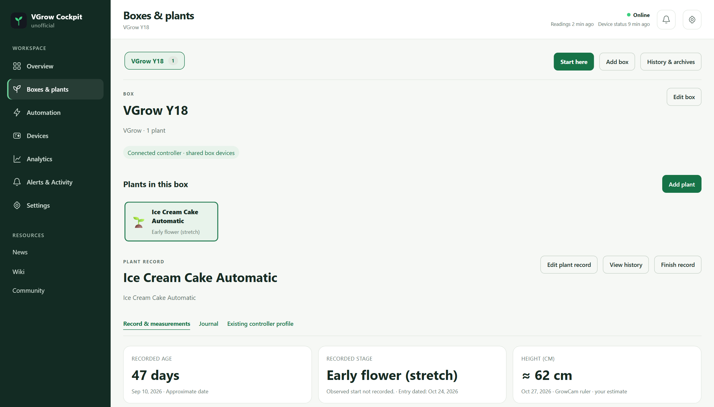

The height is an approximately 62 cm user reading from the GrowCam strip. The stage entry date is recorded while
the observed start date remains unknown. Neither field is shown as an automatic measurement.

## The indexed library

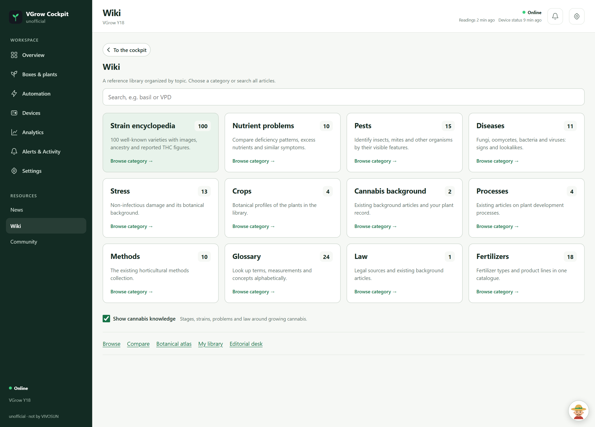

This image shows the topic index rather than copied third-party photographs. The editorial reference collection,
general plant-health categories, comparison tools, atlas, reading collections and review desk have separate entry points.

## Sensor history

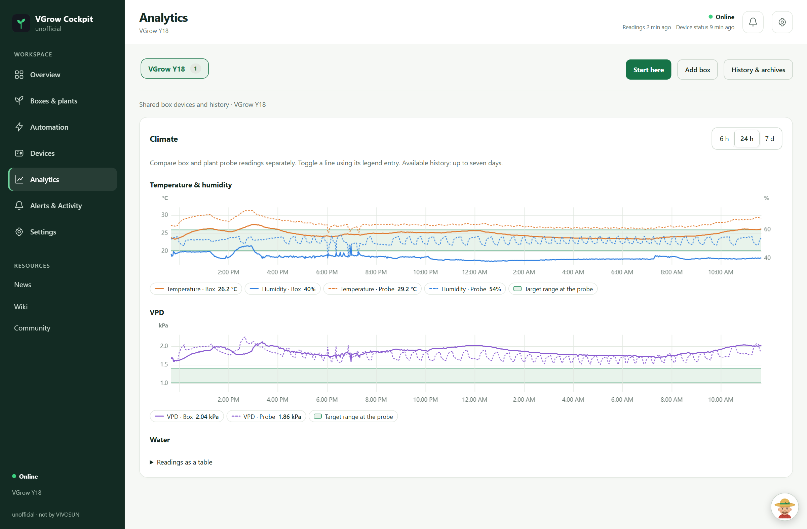

The data is from the running box. The wet/dry water signal is not rendered as a made-up continuous tank percentage.

## Mobile view

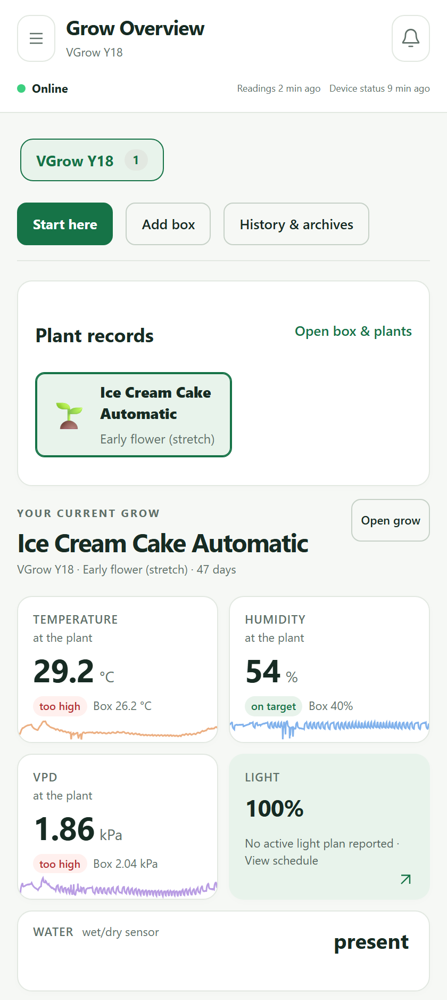

The capture uses a 420 CSS-pixel viewport with touch emulation and 2× pixel density. The UI is the same application,
with responsive navigation and stacked content.

## Hank beside the workspace

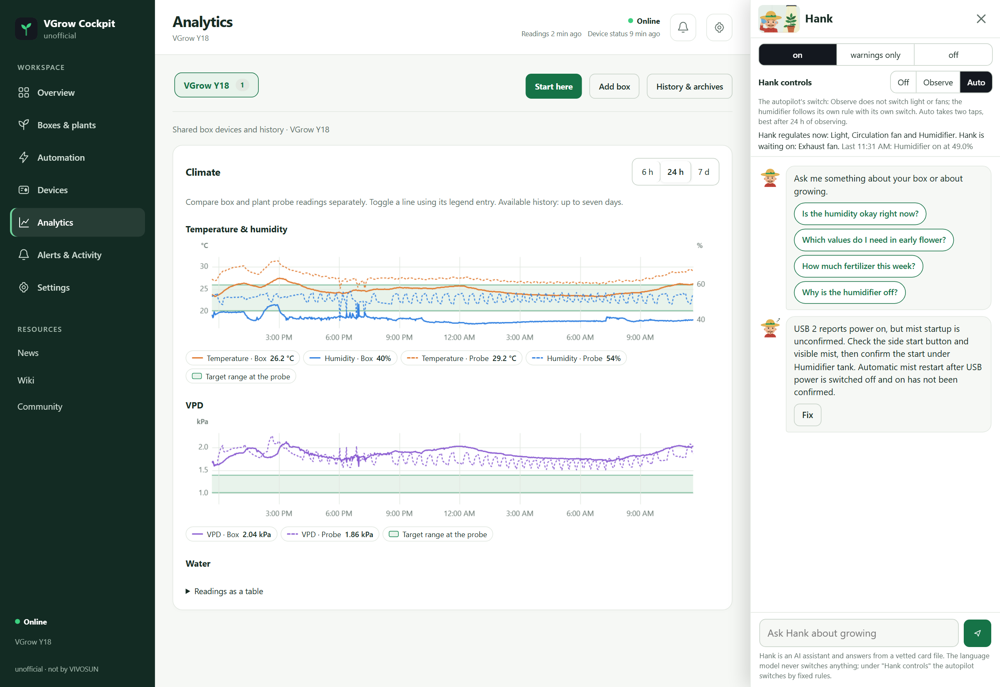

The open panel shows its Close control, current controller context and an existing notification. This capture
does not submit a question, invoke a new model analysis, or activate the displayed Fix action.

## The public community feed

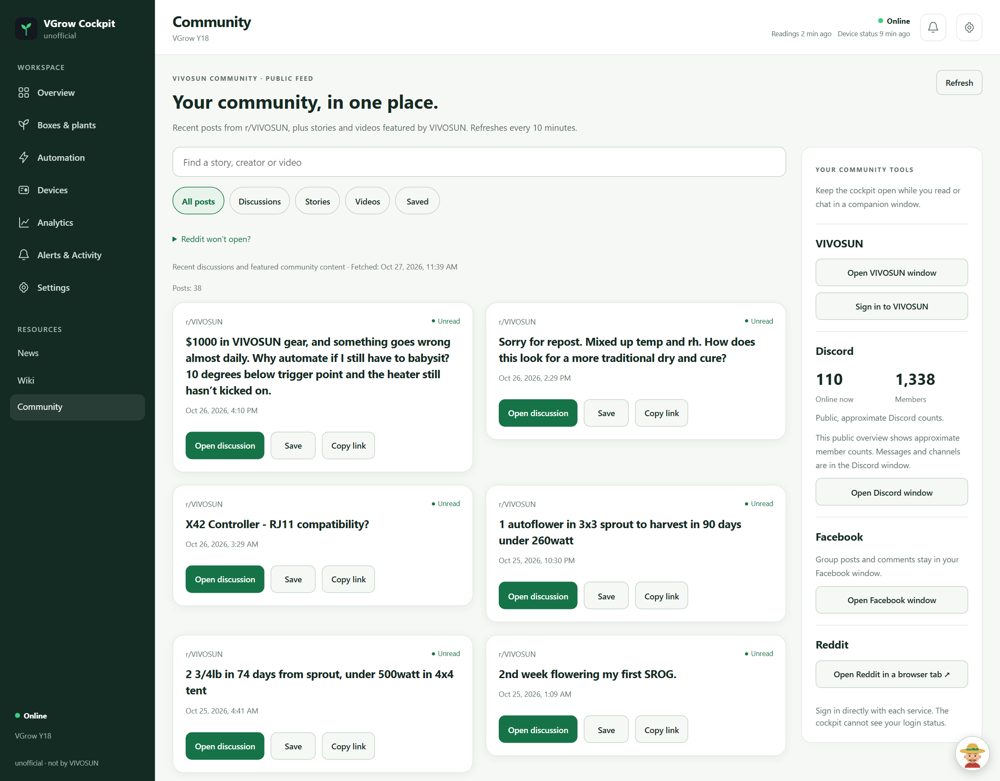

The feed renders inside the cockpit. Discussion cards whose available photos do not pass the image checks
remain text cards. The companion tools open provider pages after an explicit user action; displayed public
counts do not imply an authenticated account or private message access. Discussion titles remain their authors'
content, linked to their originals in the application; the public source is [r/VIVOSUN](https://www.reddit.com/r/VIVOSUN/).

## Capture provenance

| Property | Value |
|---|---|
| Documentation capture session | 27 October 2026, 11:39-11:40 Europe/Berlin |
| Application revision | `4e49083` |
| Source | Running Mac installation; real box, GrowCam C4 and Logitech C920 |
| Desktop capture | 1600 CSS-pixel viewport, 1.5× pixel density; card crops where useful |
| Mobile capture | 420 CSS-pixel viewport, 2× pixel density |
| Language and theme | English, light |
| Hardware commands submitted | Zero; write requests blocked and monitored |
| Browser verification | No JavaScript exceptions or horizontal page overflow during capture |
| Image treatment | Direct browser PNG captures; no generated footage or composited device values |
| File verification | Per-image dimensions, SHA-256 and capture times in the [manifest](images/capture-manifest.json) |

The cover and the [AI runtime](images/ai-runtime.svg) and [workflow](images/product-workflows.svg) maps are original SVG illustrations, not application screenshots. No credentials,
authenticated addresses, people or private account pages are included in the gallery. The repository's existing
visibility is retained. Hardware branding visible in the user's camera view belongs to its respective owner.
