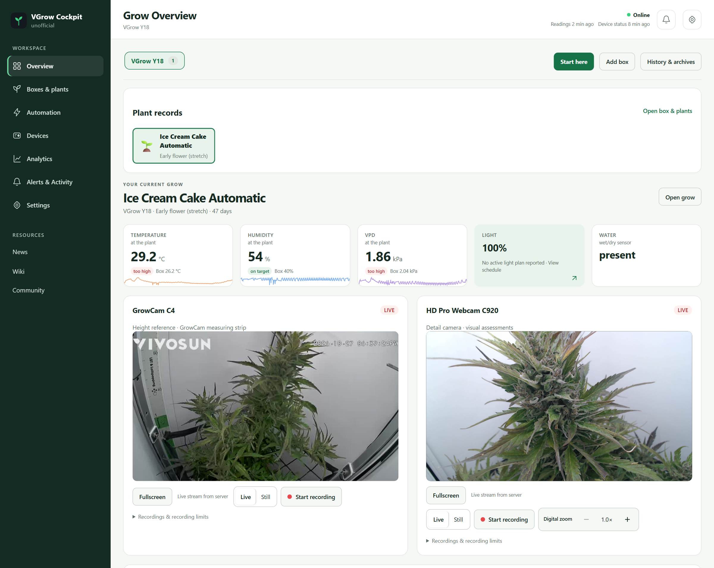
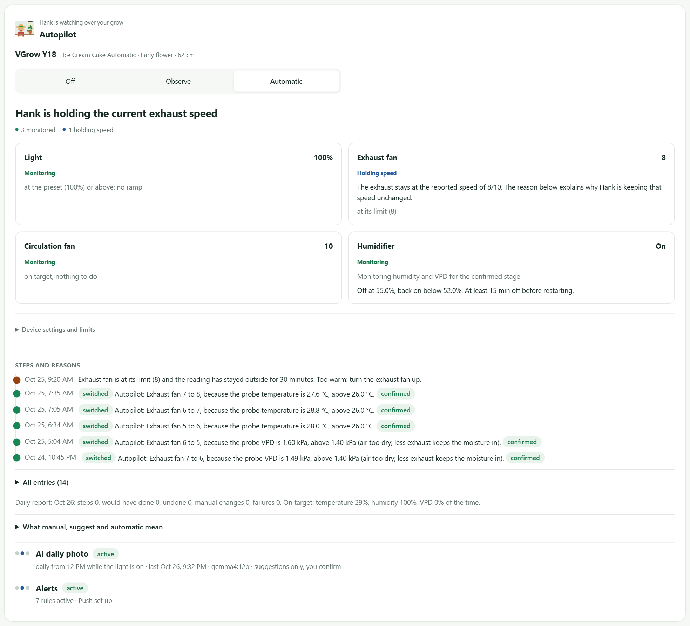
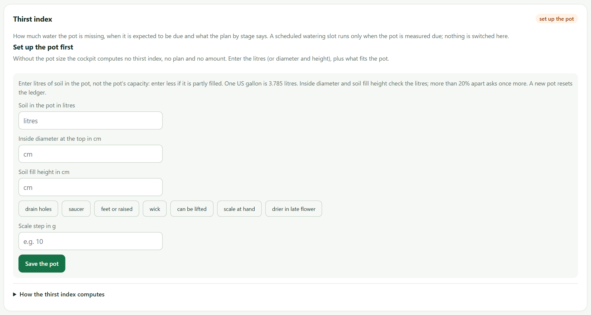
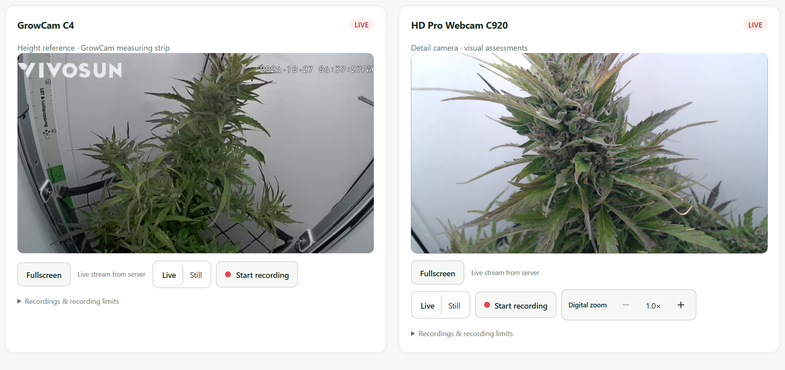
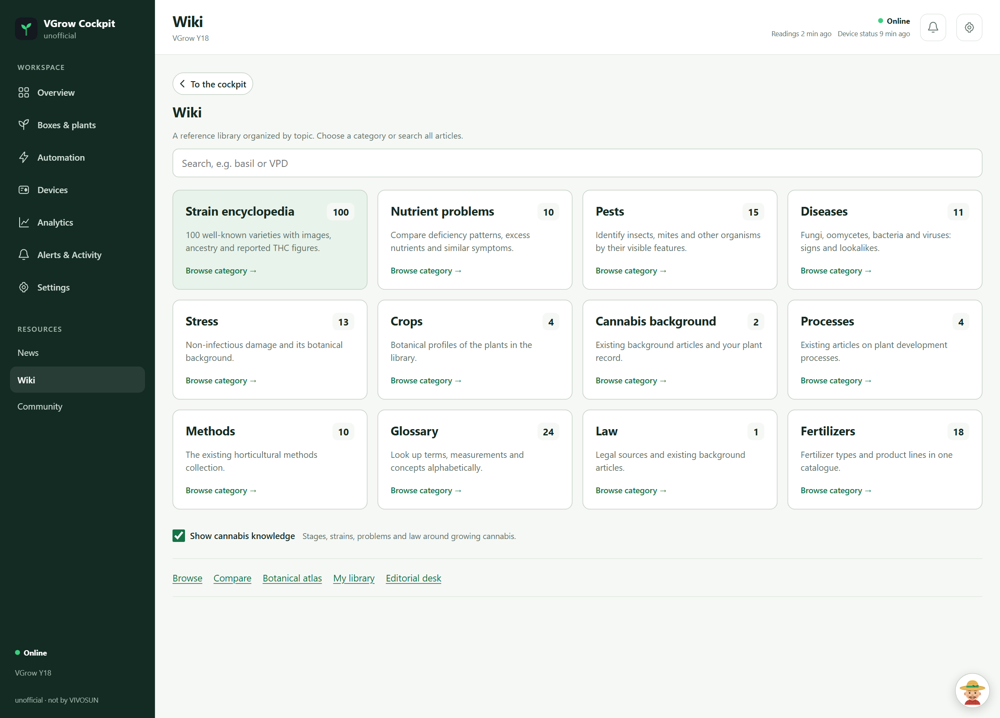

# From a phone control page to a grow workspace

[Repository](../README.md) · [Gallery](gallery.md) · [Documentation](README.md)

VGrow Cockpit began on 21 October 2026 as a practical companion to one VIVOSUN grow box. The first commit described a phone page: connect to the box, show its environment, and expose its controls. The next few days brought the questions that turned a dashboard into a product.

This story follows those questions and the implementation they produced. It describes the repository as of 27 October 2026. Proposed capabilities are identified as future work; screenshots come from the running installation. See also the [workflow map](workflows.md), [AI deployment](ai-models.md), [roadmap](roadmap.md) and [cost breakdown](costs.md).

## Starting with a box somebody actually uses

A smart box contains several systems that behave on different timescales. A temperature reading can be recent while the reported fan setting is old. A lamp can report full brightness while having no daily timer. A USB accessory can have power while doing no useful work.

The first useful job was bringing those signals onto one page. Python handles the server and the manufacturer's cloud connection; the browser presents measurements and controls. The host moved to an always-on Mac, supervised by launchd, so checking the box from a phone did not depend on leaving a development terminal open.

The first design rule followed directly from the hardware: submitting a command does not prove the device changed. The cockpit tracks acknowledgement and exposes an unconfirmed result. Readings and device status also keep separate ages. The interface can therefore answer both “what was reported?” and “how recently was it reported?”

## An empty humidifier made the missing distinction obvious

The humidifier was powered, but the tank was empty. After a refill, a physical button still needed attention before visible mist resumed. A software switch alone could not describe that situation.

The tank workflow now records the separate humidifier reservoir, its 750 ml model capacity, refills, configured mist mode, and observed runtime. An optional button reminder asks the operator to confirm mist after USB power returns. A period of weak humidity response can produce a maintenance suggestion to inspect the tank and outlet.

This is deliberately expressed as evidence with limits. The app has no remote liquid-level or flow measurement from that accessory. Remaining volume needs either a supplied output rate or suitable refill-to-empty observations. Gaps in observation and unconfirmed mist periods affect the estimate. A long period of USB power cannot quietly become a precise number of millilitres consumed.

The humidity controller also needed predictable switching. It now exposes its upper target and effective restart threshold, with a minimum off interval between cycles. The thresholds visible in the screenshots belong to this installation; they are not universal growing recommendations.

## “Waiting” needed an explanation

An exhaust fan can already be running while its controller waits before changing speed. The initial word “Waiting” made that distinction difficult to see. Meanwhile, a hot, dry enclosure can create competing demands: reducing extraction might retain moisture but work against cooling.

The automation view now shows the reported setting and the decision beside it. It distinguishes holding a speed, waiting for a timing condition, manual takeover, missing setup, and an unconfirmed command. Decision reasons connect the state to the next useful action.

The implementation separates ordinary timing rules from arbitrary command quotas. Hourly and daily actuator quotas were removed. Confirmations, assigned accessory roles, configured bounds, manual pauses, and fault handling remain part of execution. The aim is control whose behavior can be inspected and tested.

## Light output and a daily light plan are different facts

The overview originally made light brightness easy to see. It did not answer the equally important question of when the lamp would turn off.

The Light tile now opens a dedicated schedule page. It separates the last reported brightness and manufacturer control mode from a cockpit-managed daily timer. The operator can save on/off times and on-period brightness, enable the timer, and see its state and next transition.

The timer runs independently of sensor polling. While enabled, it owns scheduled light switching instead of the brightness ramp. It requires fresh evidence of manual device control with no manufacturer plan, and it reconciles the current time period after a restart or reconnection rather than replaying every missed transition.

It remains a timer hosted by the Mac, not a program installed inside the light. Automatic selection of a validated schedule from a plant's stage is still future work. The presence of a schedule editor must not be mistaken for that feature being complete.

## A pump needs a stop condition as well as a start button

Watering raised a similar question: the user wanted a repeatable duration and calendar, not just the ability to energize USB 1.

The watering controller stores run duration, local start times, the first watering date, and the interval between watering days. Its own watchdog checks the stop deadline every second. A run is persisted before the start command is sent; an interrupted run is stopped after restart rather than resumed. Missed or blocked starts are skipped.

Reported pump history also feeds Hank's factual answers. “No run recorded” is distinguished from proof that no watering happened, and powered seconds are distinguished from delivered water volume.

The next addition was a water-demand estimate and a need check before a saved slot. It combines the pot setup and observations into an estimated deficit and forecast with uncertainty. With suitable current evidence and calibrated flow, it can skip or shorten a scheduled opportunity. It cannot add a watering cycle or enlarge a saved run. This is application logic, not a language model deciding how much to pump.

The software is integrated, but the live setup still needs the actual pot details, confirmed physical switching, measured flow and an enabled schedule. Learning from repeated weighings and direct dose planning remain future work. The screenshot preserves that unfinished setup rather than presenting a staged automatic run.

## A second camera changed what could be seen

The GrowCam gives a useful view of the whole enclosure and its measuring strip. An additional Logitech C920, connected to the Mac through a USB adapter, supplies a much closer 1080p view.

Connecting it was more than adding another image URL. A macOS helper provides a recognizable camera-permission request, then shares one capture across viewers and snapshots. The camera is selected by device name; a failed external camera does not silently become the Mac's built-in camera. Audio is excluded from capture and recording.

The interface puts the feeds together, with separate controls. Digital zoom and panning belong below the image so they do not cover the very detail the user wants to inspect. Resizing fills the viewer with a proportional crop; the recording keeps its source frame.

The two perspectives also have different evidential roles. The user estimated about 62 cm from the GrowCam measuring strip. The record retains the approximate sign, camera source, date, and user-estimate origin. The C920 observation instead names its image source and visible features. A cropped image does not establish physical height, and a single photograph does not establish when a stage began.

That distinction is carried into the API, history, and exports. Provenance is part of the data, not just a caption added to a screenshot.

## One plant could no longer be the whole data model

The original setup had one box and one plant. That made a single form convenient, but it left basic lifecycle questions unanswered. What happens when the plant finishes? What if a larger box contains six plants with separate observations? What if one entry moves to a different box?

The workspace now gives boxes and plants their own identities. Each plant has independent dates, stage entries, heights, notes, and a journal. The date a stage was observed is separate from the date somebody recorded it. Editing a name or measurement does not reset a stage counter.

Finishing a record stores an end date and a frozen observation snapshot. It leaves the devices alone. The next plant gets a new record, while completed entries remain available in history and ZIP exports. Box-assignment intervals describe which shared sensor readings can legitimately be associated with a record.

Multiple records are implemented; multiple connected controllers are not yet onboarded. An unconnected box therefore shows no borrowed live readings or controls. This is a necessary distinction between a flexible workspace and hardware support that has actually been built.

## A knowledge page needed to become a library

The original handful of cards could not support the breadth of questions around varieties, symptoms, equipment, and terminology. Adding more cards to one long page made finding them harder.

The wiki now starts with an index: categories, counts, descriptions, and search. Articles have breadcrumbs and contents. The collection includes 100 editorial strain references, a separate private manufacturer catalogue with 205 product profiles, and expanded nutrient, pest, disease, and stress references.

The library also supports comparison, reported ancestry, image galleries, a botanical atlas, collections, and an editorial desk. Corrections preserve source claims and require review; a local correction does not rewrite the original reference file.

Source quality matters as much as volume. The 100 entries come from a published editorial selection, not a global statistical ranking. Reported characteristics remain attributed claims. Matching names do not prove genetic identity. Missing information stays missing, and image rights remain attached to the sources.

## Community integration had to survive the browser

Embedding a complete community site initially looked like the shortest path. In practice it produced repeated cookie dialogs and unreliable sign-in inside a third-party frame. Sending everybody away to a plain link solved only part of the experience.

The current design brings public feed metadata into the cockpit and leaves account authentication with the provider. Discussions, featured stories, and creator videos have search, saved items, and independent source health. Cached successful data survives a source outage.

VIVOSUN, Discord and Facebook pages open in top-level companion windows; Reddit discussions use normal browser tabs with copy-link and troubleshooting options. Reuse is best effort because browser isolation and mobile tab behavior differ. The product does not claim a unified social login, access to private group messages, or the ability to override a provider's network block. Photographs that fail decoding or lack sufficient resolution are omitted; text posts do not receive decorative fake covers.

## Hank belongs beside the system, with a defined role

The assistant combines current measurements, controller reports, recorded actions, and the reference library. Deterministic answers handle facts such as pump history. A local Ollama model can provide language and visual interpretation, while semantic retrieval has its own optional embedding model.

The actual installation uses Gemma 4 12B for language and vision and Granite Embedding 278M for semantic retrieval, through Ollama on an owner-operated Intel Mac with 16 GiB RAM. We built the application, evidence pipeline and orchestration around pretrained weights; we have not trained those base models ourselves.

The available Mac has a finite memory and processing budget. Chat and image analysis share one model queue, and benchmark reports record the cost of cold starts and memory pressure. There is no external LLM provider API key or per-request inference bill in this deployment. Hardware, electricity and engineering still have costs, separated in the [cost breakdown](costs.md).

Hank is optional. The server initializes it after the essential services, and controllers keep their own state machines. A model failure must not become a reason that a pump loses its deadline or a humidity rule stops evaluating.

## What the product is growing toward

The next steps follow the same pattern: connect more hardware through explicit adapters; make device ownership clear across boxes; validate camera measurement against a known reference; and associate photos and model observations with the correct plant records.

Those are engineering tasks with evidence requirements. A universal device layer needs protocol-specific capabilities and failure handling. Automatic height needs visible endpoints and calibration. Automatic stage onset needs a dated observation history. A calibrated pump dose needs measured flow.

The work already in this repository provides the foundation: a responsive interface, persistent observations, reported hardware outcomes, independently timed controllers, and a local assistant that can explain the evidence. The next features should extend those foundations with the same care. The [roadmap](roadmap.md) marks implemented, enabled and still-unvalidated work separately.

## From an owner's problem to a contribution

The goal is to make the equipment easier to use, especially for somebody who does not already know how to translate a reading into the right routine. The ambition is less recurring intervention, with refills and physical maintenance made clear. The current installation does not yet establish fully unattended care.

I would like to bring the working product and what I learned into collaboration with VIVOSUN, including a possible role in product development, integration and testing. A focused demonstration and pilot can establish what improves the experience and what needs more engineering.

The [separate showcase](../showcase/README.md) supports that introduction while the implementation remains private. It shares evidence of the product without distributing source, private prompts, calibration logic or model weights.

Continue with [architecture](architecture.md), [installation](getting-started.md), or the [complete documentation index](README.md).
