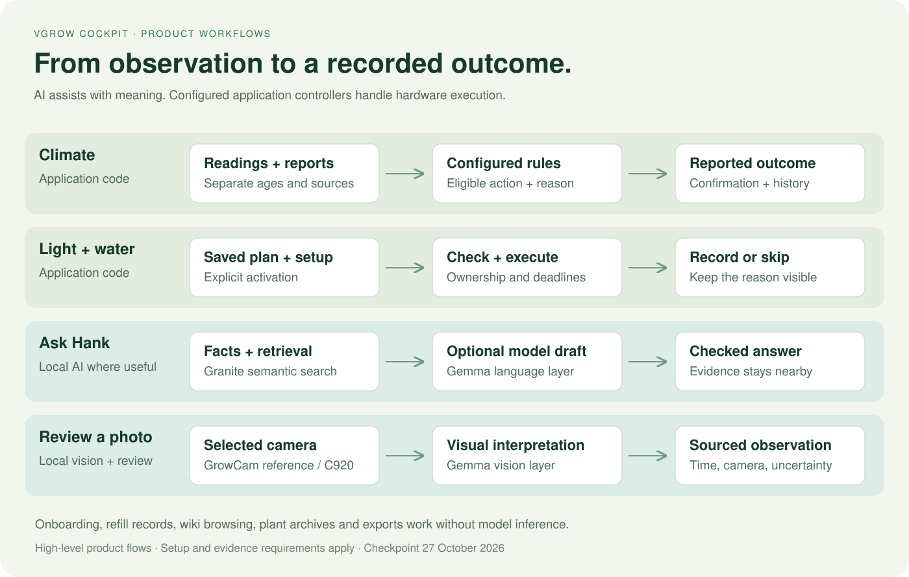

# How the product works

[Product overview](../README.md) · [AI models](ai-models.md) · [Gallery](gallery.md) · [Roadmap](roadmap.md)

The cockpit connects an observation to a useful next step, then preserves what happened. The flows below describe product behavior at a high level. They do not publish the implementation or calibration formulas.

## 1. Connect a box and start a plant record

**Operator adds a box → creates a plant record → records the starting point → follows that record's history.**

The starting point may be a seed, an existing plant or a later stage. Dates can be approximate, and an observed stage start is separate from the date entered. Multiple plants can belong to one box. Shared box sensors remain shared measurements.

**AI:** not required. Optional camera observations can be added later. **Current boundary:** the installation controls one connected VGrow controller; adding a box record does not automatically connect more hardware.

## 2. Observe the environment and explain a control decision

**Readings and device reports arrive → configured controllers evaluate conditions → eligible actions use the command path → reported outcomes enter history.**

The interface keeps sensor age and device-report age separate. It explains when a fan is holding speed, an action is waiting, a setting was changed manually, or confirmation is missing. A sent command is not proof of a physical result.

**AI:** not required for climate control. Hank can explain the available state. **Current boundary:** the host and manufacturer connection must be available; a model answer does not override device state.

## 3. Manage the light's day

**Save daily on/off times and brightness → enable the timer → follow the current time period → confirm reported output and show the next switch.**

The timer owns scheduled light switching while enabled. Brightness and daily timing remain separate settings. Existing manufacturer plans are not overwritten. On restart, the controller reconciles the current period rather than replaying every missed event.

**AI:** not required to execute the timer. **Current boundary:** automatic selection of a validated stage-specific schedule is planned. The captured installation's timer is disabled and unconfigured; it must not be described as already following a daily plan.

## 4. Water at a scheduled opportunity, after a need check

**Set up the pot and confirm physical pump behavior → measure flow → save watering opportunities → check current need → skip or shorten the slot → run with a stop deadline → preserve the outcome.**

The thirst index presents an estimated deficit and forecast with uncertainty. Scheduled execution also needs a recent pot observation and suitable calibration. The need check can skip or shorten an existing slot; it does not create extra starts, extend a run or replay missed watering. A manual one-off action remains a separate operator action.

**AI:** not required for the water calculation, eligibility decision or stop watchdog. **Current boundary:** USB power is not a flow measurement. The live installation still lacks saved pot setup and an enabled watering schedule. Learning from repeated weighings and direct dose planning remain future work.

## 5. Keep the humidifier useful

**Record a refill → confirm visible mist when needed → follow humidity control and runtime → inspect the tank or outlet when the evidence suggests poor response.**

The separate 750 ml humidifier reservoir needs physical refilling. A power report cannot prove that the side button was pressed or mist restarted. Consumption estimates depend on usable observations or a supplied rate; unknown volume remains unknown.

**AI:** not required for switching, refill records or maintenance checks. Hank provides a readable explanation. **Current boundary:** there is no remotely measured tank level or mist-flow signal from this accessory.

## 6. Ask Hank about the actual installation

**Question → current facts and relevant references → direct factual response or local model draft → application checks → answer with its evidence.**

Granite embeddings help find relevant reference text. Gemma supplies the optional language layer. Recorded events and calculations can answer operational questions directly. Failure to run the model does not stop the cockpit's core controls.

**AI:** local Granite retrieval and optional Gemma generation. **Current boundary:** finite host memory and CPU time; generated explanations can be wrong and are not direct control authority.

## 7. Interpret an image without inventing a measurement

**Choose GrowCam or C920 → acquire an image → local vision interpretation → review the observation → store its source and time.**

GrowCam is the height-reference view; C920 is the detail view. Daily photo analysis can produce suggestions for review. The approximate 62 cm value currently recorded is a user reading from the measuring strip, not an automatic camera measurement.

**AI:** local Gemma vision. **Current boundary:** a single image does not establish the date a stage began. Validated physical height and longitudinal stage recognition remain planned.

## 8. Learn, connect and keep a complete history

**Browse the wiki, news or public community feed → inspect the source → save useful items → keep account interactions with the provider.**

The knowledge index avoids duplicating the entire library on one page. Public community metadata stays inside the cockpit; provider windows or browser tabs handle account features. Provider network blocks and private feeds remain outside the cockpit's control.

**Finish a plant record → preserve its snapshot and assignment history → export available records → create a successor with a new identity.** Finishing a record does not itself switch the hardware.

**AI:** not required for browsing, lifecycle storage or exports. Optional interpretation can enrich an observation. **Current boundary:** attributing every shared camera image and AI result to individual plants needs further work.
